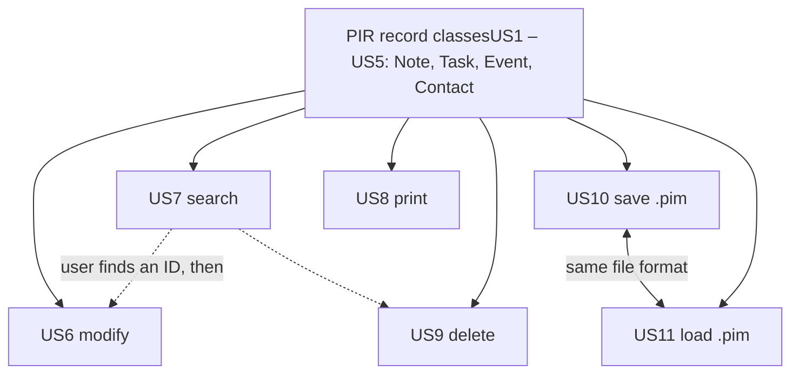
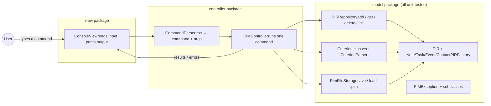
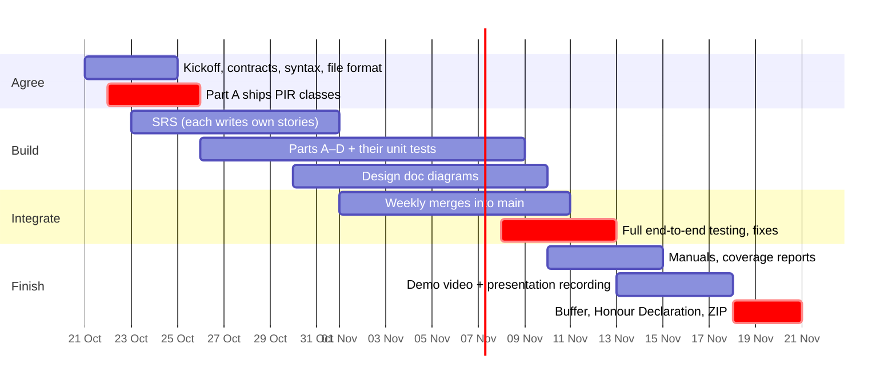

COMP3211 · Group project · due 20 Nov 2026, 20:00

# PIM Team Work Plan

How four people can split the 11 user stories, what everyone must agree on before writing code, and how the pieces come back together. Names in code are Python style. Java teams can use the same names in camelCase.

## 1. Why splitting by user story doesn't work

You're right that the stories are connected. Almost every story uses the **PIR record classes** from US1–US5. Search (US7) reads their fields, saving (US10) writes them out, and loading (US11) rebuilds them. If four people each wrote their own version of a "task", the parts would not fit together.



Everything depends on the record classes, so they get designed first and frozen. After that, each part can be built on its own.

So split the work by **component** instead of by story. Each component covers a group of stories and talks to the others only through a small, agreed interface.

## 2. Architecture: Model–View–Controller

The brief already asks for a `model` package and points to MVC. Use three packages. The arrows show which part may call which. Nothing calls upward.



Rule: the model never prints and never reads input. Only the view does input and output. That's what makes the model testable with plain unit tests.

Put the **search-expression parser in the model**, not the controller. It's the most complex logic in the system, so you want it covered by unit tests, and the brief only counts coverage on the model.

## 3. The four parts

### Part A · Records

US1 US2 US3 US4 US5 US6

Builds (model)

`PIR` base class, `Note`, `Task`, `Event`, `Contact`, `PIRFactory`, date-time parsing and formatting, field validation, `set_field` for modify.

Why together

Creating and modifying both need the same field definitions and validation rules.

Critical path

Pushes working classes by **25 Oct**. Everyone else builds on them.

Also leads

Editing the SRS.

### Part B · Repository & CLI

US8 US9 + app shell

Builds

model: `PIRRepository` (IDs, add, get, delete, list). controller: `CommandParser`, `PIMController`. view: `ConsoleView`, `main`, help text, error messages.

Why together

Print and delete are thin features. Most of the work is the shell every other feature plugs into.

Role

**Integrator**: merges branches and keeps `main` running.

Also leads

Editing the user manual.

### Part C · Search

US7

Builds (model)

`Criterion` interface, `TypeCriterion`, `TextContainsCriterion`, `TimeCompareCriterion`, `AndCriterion`, `OrCriterion`, `NotCriterion`, `CriterionParser`.

Why alone

It's the hardest story: a small expression language with `&&`, `||`, `!`, brackets and precedence. It needs the most tests too.

Starts

Right away, using fake PIRs, because it only needs the PIR *interface*.

### Part D · Persistence & quality

US10 US11 + reports

Builds (model)

`PimFileStorage`: `.pim` format, escaping, `.pim` extension check, handling corrupt or missing files, keeping IDs across save and load.

Why together

Save and load must use the same format, so one person owns both.

Also leads

Coverage tool setup, test coverage report, requirements coverage report, design document, developer manual.

**Balance check.** A has the least code but sits on the critical path and edits the SRS. C has the hardest logic. B and D have lighter features but carry the integration and reporting work. Agree on contribution percentages early, since they go in the Honour Declaration and change everyone's mark.

## 4. Interfaces to agree before anyone codes

These are the joints between parts. Write them into a shared file (e.g. `CONTRACTS.md` in the repo) at the first meeting. Once agreed, no one changes them without telling the group. These signatures can go straight into design document section 2.b.

### 4.1 PIR (owned by Part A, used by everyone)

```
class PIR (abstract)
    get_id() -> int
    get_type() -> str                    # "note" | "task" | "event" | "contact"
    get_text_fields() -> dict[str, str]  # used by search "contains"
    get_time_fields() -> dict[str, datetime]   # used by search < > =
    set_field(name: str, value: str) -> None   # raises InvalidFieldException
    to_detail_string() -> str            # used by print
    to_record() -> dict[str, str]        # used by save

PIRFactory.create(type: str, id: int, fields: dict[str, str]) -> PIR   # used by create + load
```

Search and storage depend **only** on these methods, never on the subclasses. That's what lets Part C and Part D build at the same time as Part A.

### 4.2 Fixed field names and formats

| Type | Text fields | Time fields |
| --- | --- | --- |
| note | `text` | none |
| task | `description` | `deadline` |
| event | `description` | `start`, `alarm` |
| contact | `name`, `address`, `mobile` | none |

- One date-time format everywhere (input, output, file): `YYYY-MM-DD HH:MM`, e.g. `2026-11-20 20:00`.
- IDs are whole numbers handed out by the repository, never reused, and kept in the `.pim` file.
- Mobile number is stored as text. It's a "contains" field in US7, not a number.

### 4.3 Other component interfaces

```
# Part B
PIRRepository.add(pir: PIR) -> int
PIRRepository.get(id: int) -> PIR            # raises PIRNotFoundException
PIRRepository.delete(id: int) -> None        # raises PIRNotFoundException
PIRRepository.get_all() -> list[PIR]
PIRRepository.search(c: Criterion) -> list[PIR]
PIRRepository.replace_all(pirs: list[PIR]) -> None   # used after load

# Part C
Criterion.matches(pir: PIR) -> bool
CriterionParser.parse(expr: str) -> Criterion        # raises InvalidCriterionException

# Part D
PimFileStorage.save(path: str, pirs: list[PIR]) -> None    # raises PimFileException
PimFileStorage.load(path: str) -> list[PIR]                # raises PimFileException

# Shared exceptions (Part A creates the file on day 1)
PIMException
 ├─ InvalidFieldException      ├─ PIRNotFoundException
 ├─ InvalidCriterionException  └─ PimFileException
 └─ InvalidCommandException    (controller)
```

### 4.4 Command syntax (draft for the SRS and user manual)

```
create note    text="Buy milk"
create task    description="Submit SE project" deadline="2026-11-20 20:00"
create event   description="Group meeting" start="2026-10-24 14:00" alarm="2026-10-24 13:45"
create contact name="Chan Tai Man" address="Hung Hom" mobile="91234567"
modify 3 deadline="2026-11-19 23:59"
search type = task && deadline < "2026-11-20 00:00" && !(description contains "draft")
print 3          print all          delete 3
save work.pim    load work.pim      help      exit
```

Search grammar for Part C. `!` binds tightest, then `&&`, then `||`.

```
expr  := and ( "||" and )*
and   := unary ( "&&" unary )*
unary := "!" unary | "(" expr ")" | atom
atom  := "type" "=" TYPE
       | FIELD "contains" STRING
       | FIELD ( "<" | ">" | "=" ) DATETIME
```

Group decision to make: should a criterion on a field a record doesn't have (e.g. `deadline < …` on a note) be false or an error? Pick one and write it in the SRS.

### 4.5 .pim file format (draft for Part D)

```
PIMFILE v1
1	note	text=Buy milk
3	task	description=Submit SE project	deadline=2026-11-20 20:00
4	contact	name=Chan Tai Man	address=Hung Hom	mobile=91234567
```

Tab-separated, one record per line. Tabs, newlines and backslashes inside values are escaped as `\t`, `\n` and `\\`. The header line lets `load` reject files that aren't PIM files.

## 5. Project layout

```
pim/
├── model/        pir.py note.py task.py event.py contact.py pir_factory.py
│                 repository.py criteria.py criterion_parser.py storage.py exceptions.py
├── controller/   command_parser.py pim_controller.py
├── view/         console_view.py
├── main.py
├── tests/        test_pir.py test_repository.py test_criteria.py
│                 test_criterion_parser.py test_storage.py
├── RequirementsCoverage.pdf
├── TestCoverage.pdf (or html)
└── CONTRACTS.md
```

For Java, use `src/model`, `src/controller` and `src/view` packages and `test/model` with JUnit.

## 6. Timeline to 20 November



## 7. Rules for combining the parts

1. **One shared repository** (private GitHub). `main` must always run. Each part works on its own branch and merges through a pull request that one other member reviews.
2. **Merge only with passing tests.** Run the full test suite before every merge.
3. **Merge every week, not once at the end.** Leaving it all to the last week is where group projects break.
4. **Don't wait on each other.** Before the real classes exist, test against small fake PIRs or a fake repository.
5. **Change a contract only after telling the group.** Update `CONTRACTS.md` in the same pull request.
6. **Each part writes its own unit tests**, one file per model module. Every test gets a comment saying what it checks and assertions for the expected result, as the brief requires.
7. **Standard library only** in the system code. A coverage tool (coverage.py or IntelliJ/JaCoCo) is fine for measuring tests.
8. **Keep a GenAI log** of what was made with AI help, this plan included, for the Honour Declaration.

## 8. Who writes what in the documents

Everyone writes the sections for their own part. The editor merges them and makes the style consistent.

| Deliverable | Editor | Each member contributes |
| --- | --- | --- |
| SRS | A | Functional and non-functional requirements for their own stories |
| Design document | D | Class descriptions for their own classes. B draws the search-and-update sequence diagram. |
| User manual | B | The commands for their own features, with examples and error cases |
| Developer manual | D | Short; D writes it |
| Coverage reports | D | Mark which of their requirements are done |
| Demo video (≤ 4 min) | C | A script of the features to show |
| Presentation (≤ 5 min, ≥ 1 min each) | C | A: creating a PIR. C: search criterion and search. B: overall design. D: lesson learned (unit testing). |

The presentation split falls out naturally: each person presents the part they built, and every member gets at least one minute. Remember to show your face and student ID card at the start of your section.